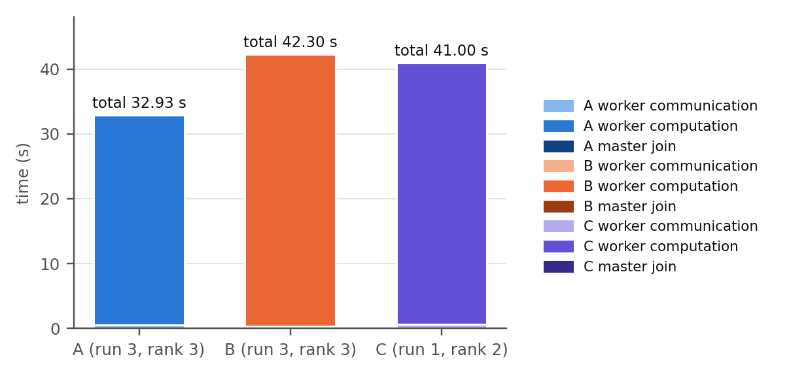
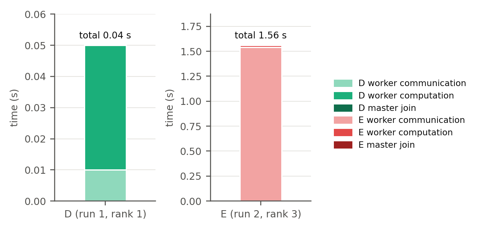

# CS3210 Tutorial 08 Report (A0308298R)

## Results

Each command was run 5 times. The raw data is described in the appendix. Exercises 10 and 11 refer to the graphs below.

Designations: A for `i7-7700`-only, B for `xs-4114`-only, C for mixed (Exercise 10). D for 5 tasks, E for overcommitted 9 tasks (Exercise 11).

Each bar is the slowest worker of the median run (by master total time). Join is the master total minus that worker's communication and computation. D and E use separate y-axes.

 

## Exercise 10

Computation time dominates every run, so node speed is a bigger factor in the result.  The `i7-7700` at `FrequencyBaseMHz=3600` has a higher clock frequency than `xs-4114` at `FrequencyBaseMHz=2200`. 

The `i7-7700` has 8 PUs and the `xs-4114` 20, but the latter's extra PUs go unused in B, since 5 processes already get one PU each on both nodes, so it does not help improve the performance compared to A.

The C run lands in between. The runs placed 3 ranks on the `xs-4114` and 2 on the `i7-7700`. Rows are split equally, so the `i7-7700` workers finish early and sit idle while the master waits for the slower `xs` workers. 

Both types of nodes in the C run compute slightly faster than in the A or B run, likely because fewer processes per node means less contention for the shared cache and memory bandwidth.

But since the master thread still has to wait on the slowest `xs-4114` nodes, C can perform better than the B run but not the A run. 

## Exercise 11

D outperforms E as D is not oversubscribed while E is. With 9 processes on 8 PUs, one rank is always de-scheduled. Blocking MPI calls force waiting ranks to spin instead of letting another rank do useful work.

Any message involving the de-scheduled rank must then wait for the OS to replace a spinning rank with it, which balloons the communication time when working on a large matrix. 

As a result, the slowdown comes from communication which far dominates the computation time.  

With 5 processes, every rank has its own PU, so the messages never wait. This keeps the communication time low, which makes it faster.

## Exercise 12

Performance can be improved by making the waiting ranks yield their PUs instead of spinning. 

Replace each blocking `MPI_Recv` and `MPI_Send` with `MPI_Irecv` or `MPI_Isend`, then loop on `MPI_Test` with a sleep until the request completes. 

An idle rank then gives up its PU so a descheduled rank able to do important work can run without being held up. 

All 9 processes still exchange the same messages and do the same computation. Only the way they wait changes, so the result stays correct.

## Appendix

Repository: <https://github.com/CrunchyBiscuit19/cs3210-T08>

`mm-mpi.cpp` is the provided program, used unmodified.

Each script runs its configuration 5 times and collects the timing of every process into a CSV file.

| Script          | Equivalent `srun` command                                                                        |
| --------------- | ------------------------------------------------------------------------------------------------ |
| `ex10_i7.sh`    | `srun --nodes=1 --ntasks=5 --partition=i7-7700 --cpu-bind=thread ./mm-mpi 2048`                  |
| `ex10_xs.sh`    | `srun --nodes=1 --ntasks=5 --partition=xs-4114 --cpu-bind=thread ./mm-mpi 2048`                  |
| `ex10_mixed.sh` | `srun --nodes=2 --ntasks=5 --constraint="[i7-7700*1&xs-4114*1]" --cpu-bind=thread ./mm-mpi 2048` |
| `ex11_n5.sh`    | `srun --ntasks=5 --nodes=1 --partition=i7-7700 ./mm-mpi 256`                                     |
| `ex11_n9.sh`    | `srun --ntasks=9 --nodes=1 --overcommit --partition=i7-7700 ./mm-mpi 256`                        |
`results/ex10_*.csv` and `results/ex11_*.csv` hold one row per process per run. 

Each `results/*.out` file holds the full program output of one sample run. 

`results/i7_specs.txt` and `results/xs_specs.txt` hold the `lstopo` output for each node type, which is where the hardware claims are sourced from.

`figures/plot_ex10.py` and `figures/plot_ex11.py` generate `figures/ex10.png` and `figures/ex11.png` from the CSVs.
